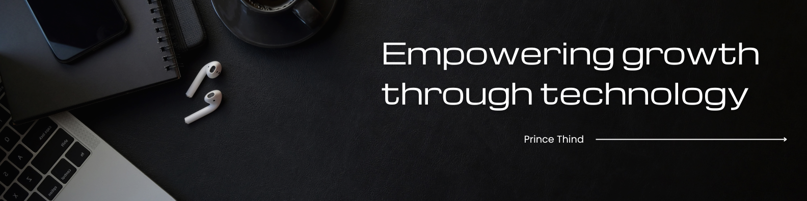

 

  <a href="YOUR-PORTFOLIO-LINK">
    <kbd>
      
    </kbd>
  </a>

# IT Support | Systems Administration | Linux & Cloud Operations

I'm an IT enthusiast with a strong interest in technical support, systems administration, Linux, networking, and cloud technologies. I enjoy troubleshooting technical issues, understanding how systems work, and finding practical solutions to everyday technology challenges.

With a **CompTIA A+ certification** and a foundation in computer science, I've been developing my technical knowledge through independent projects, hands-on labs, and continuous learning. My interests include IT support, desktop support, Windows and Linux environments, system configuration, networking, and cloud infrastructure.

I believe effective IT support goes beyond fixing technical problems. It involves understanding user needs, communicating clearly, documenting solutions, and ensuring technology works reliably. I'm particularly interested in roles where I can combine technical troubleshooting with customer service and continue developing my infrastructure and cloud skills.

## Technical Skills

- **IT Support:** Help Desk, Desktop Support, Technical Troubleshooting, Remote Support.
- **Operating Systems:** Windows, Linux, Ubuntu.
- **Systems Administration:** User Management, Permissions, System Configuration, SSH.
- **Networking:** TCP/IP, DNS, DHCP, VPN, Network Troubleshooting.
- **Cloud & Infrastructure:** Cloud Computing, AWS Fundamentals, Server Administration.
- **Web Technologies:** HTML, CSS, JavaScript, Web Operations.
- **Tools & Technologies:** Git, GitHub, Bash, RDP, TeamViewer.

## Key Strengths

- **Technical Troubleshooting:** Identifying, diagnosing, and resolving hardware, software, operating system, and connectivity issues.
- **Systems Knowledge:** Understanding operating systems, system configurations, user permissions, and basic infrastructure management.
- **Customer Support:** Communicating technical information clearly and helping users resolve their technology-related problems.
- **Continuous Learning:** Building practical skills through personal projects, certifications, technical labs, and independent learning.
- **Documentation:** Recording technical configurations, troubleshooting steps, and solutions for future reference.

## Education & Certification

- **CompTIA A+** – Certified IT Professional.
- **Lovely Professional University (LPU)** – Computer Science and Engineering.
- **Northern College of Applied Arts and Technology** – Information Systems Business Analysis

## What I'm Working Towards

I'm continuously expanding my knowledge in IT support, Linux administration, networking, cloud technologies, and systems operations. I enjoy experimenting with new tools, building personal projects, and developing practical skills that translate into real-world IT environments.

I'm particularly interested in opportunities across:

- IT Support Specialist
- Help Desk / Service Desk Analyst
- Technical Support Specialist
- Desktop Support Technician
- Junior Systems Administrator
- Linux Support Administrator
- Cloud Support Associate
- IT Operations Support

## A Little More About Me

- Currently strengthening my Linux and systems administration skills.
- Building personal projects and hands-on technical labs.
- Interested in cloud infrastructure and automation.
- Passionate about troubleshooting and learning how technology works.
- Always open to collaborating on interesting technical projects.

**Learn → Build → Troubleshoot → Document → Improve.**

Thanks for visiting my profile!

# Some GitHub Statistics

  

